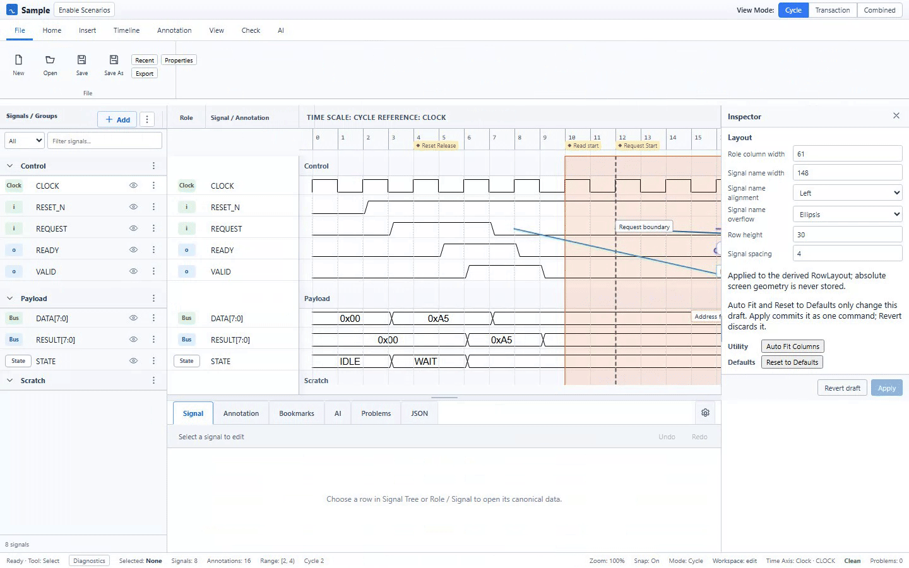
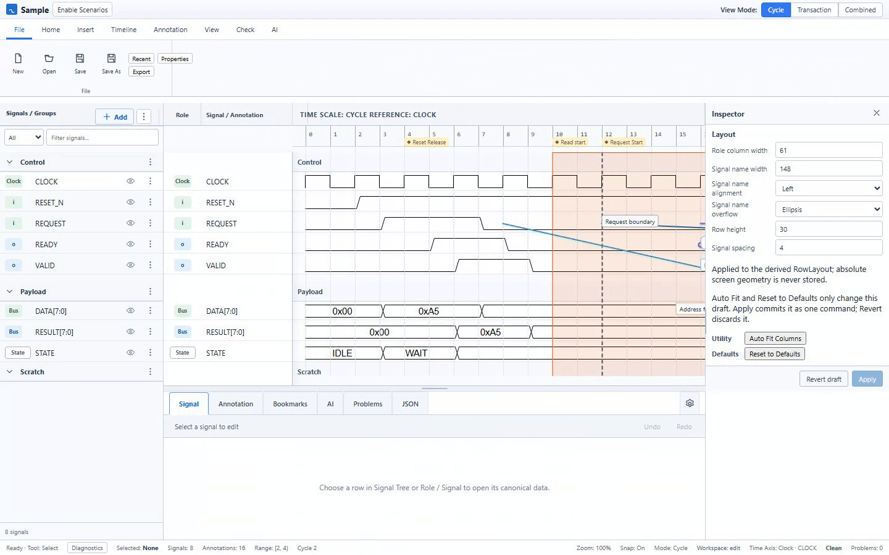
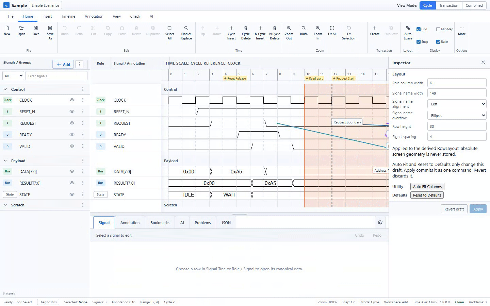
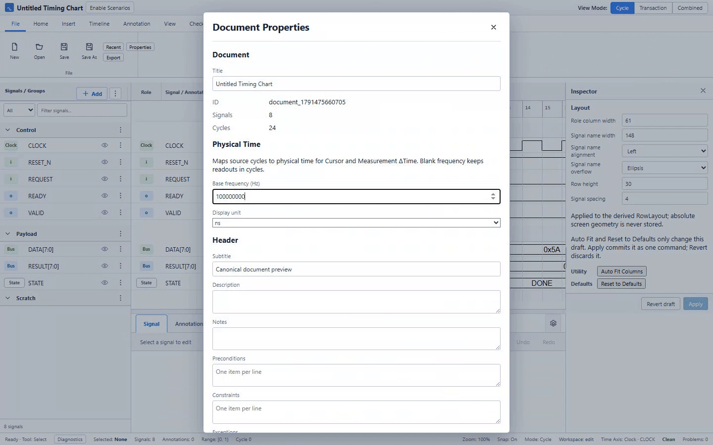
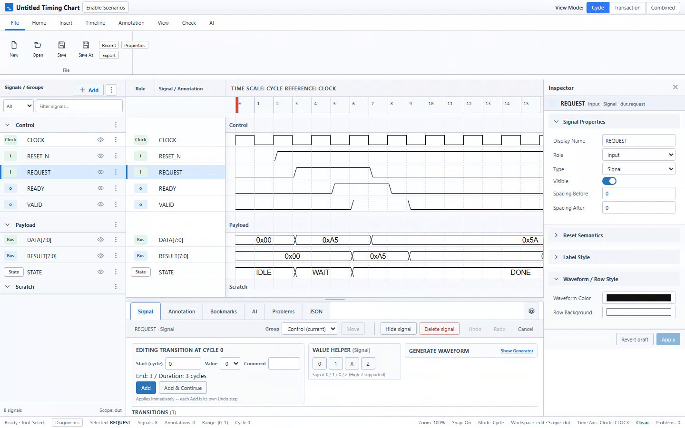
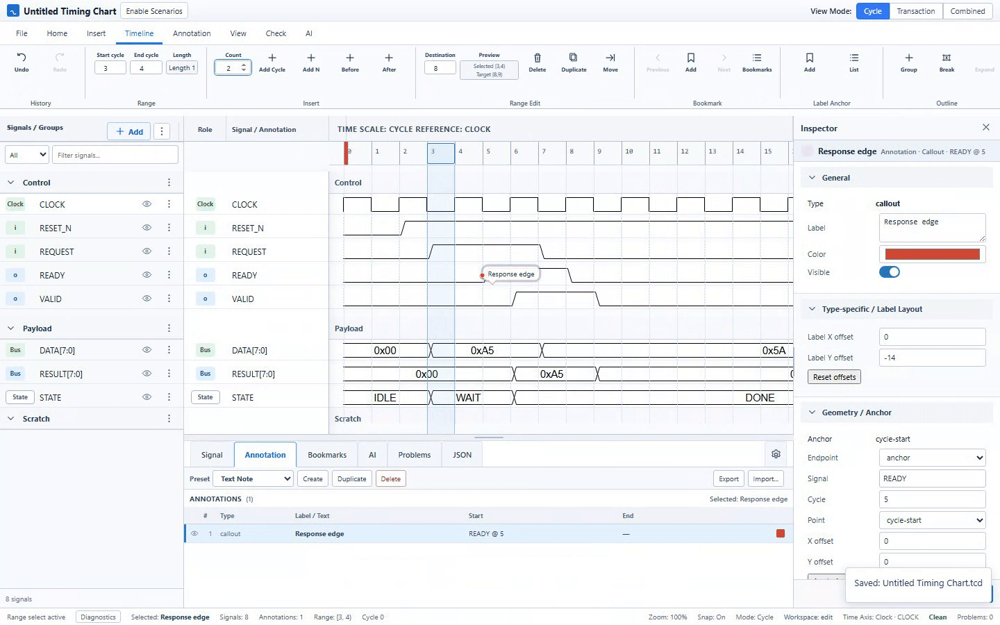
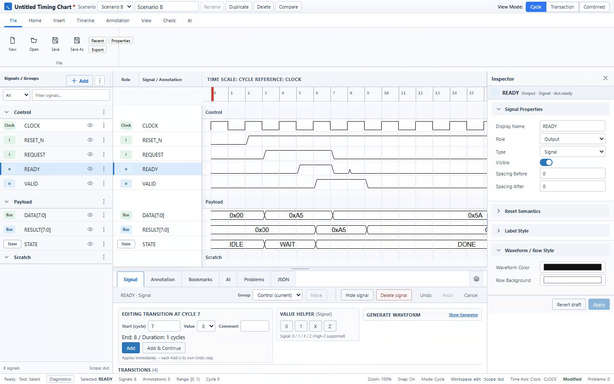
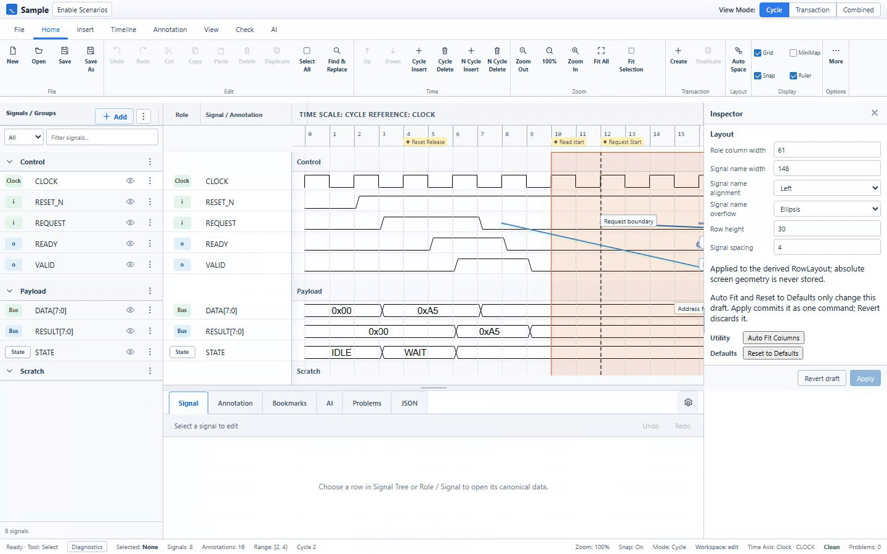

# Semiconductor Timing Chart Editor

半導体仕様書の信号波形、Transaction、時間関係をブラウザで編集し、SVG、PNG、PDFへ出力するツール。



## チャートの作成

信号は各Cycleの値を埋めるのではなく、値が変わる位置の`start/value`を編集します。
Clock、Binary、Bus、Stateを並べ、GroupとSpacerで配置を整理できます。
下パネルで変化点を追加すると、中央の波形が更新されます。



## Cycle ViewとTransaction View

Cycle Viewは信号波形、Transaction Viewは期間とPhaseを表示します。
Combined Viewでは両方を上下に並べ、同じsource timeを共有して確認できます。



## 時間関係の計測と注記

Measurementで2点のCycle差を表示できます。
Document Propertiesで基準周波数と単位を設定すると、物理時間の差も表示します。
下の例は100 MHzで2 cyclesが20 nsになる計測です。



Arrow、Range、Calloutで信号間の関係や有効区間を注記できます。



## Timelineの編集

時間範囲へCycleを挿入すると、後続の変化点とAnnotationも追従します。
UndoとRedoで編集を戻したり、やり直したりできます。



## Scenarioの比較

Scenarioを複製して別の信号パターンを編集し、Compareで差分区間を確認できます。
「Show in timeline」で該当信号と時間範囲を選択します。
Scenarioの切り替えと比較は文書データを変更しません。



## 保存と画像出力

Saveで再編集可能な文書を保存します。
File → ExportではSVG、PNG、PDFを選び、出力範囲やページ設定を指定できます。



## ローカルで起動する

Node.js 22.12以上とnpmを用意し、リポジトリの`timing-chart-v2`で実行します。

```sh
cd timing-chart-v2
npm ci
npm run dev
```

起動ログに表示されたURLを開きます。
公開配布物の確認手順は[ローカルリリース手順](docs/LOCAL_RELEASE.md)を参照してください。

## 最初のチャート

1. Cycle ViewでFile → Newを選びます。Newには標準Signalが入っています。
2. 3信号だけで始める場合、Home → Select All Signals → Deleteで標準Signalを削除します。
3. 左パネルのAddからGroupを作り、Clockを追加します。Inspectorで名前を入力してEnterで確定し、Use as Reference Clockを選びます。
4. AddからSignalを2つ作り、VALIDとREADYに名前を変えます。
5. 下パネルでNew event startとNew event valueを指定してAddします。VALIDはCycle 2で1、Cycle 5で0、READYはCycle 3で1、Cycle 5で0を入力します。
6. 波形を確認し、File → Saveで文書を保存します。File → ExportでSVGを出力できます。

詳しい手順は[5分のQuick Start](timing-chart-v2/docs/QUICK_START.md)を参照してください。
操作映像の再生成方法は[READMEデモの手順](timing-chart-v2/docs/README_DEMOS.md)にあります。
機能別の説明は[User Manual](timing-chart-v2/docs/USER_MANUAL.md)を参照してください。

## 開発と設計資料

以下は製品仕様、データ形式、描画契約の基準資料です。

## Source of truth
- `timing-chart-v2/docs/PRODUCT_SPEC.md`
- `timing-chart-v2/docs/DATA_FORMAT.md`
- `timing-chart-v2/docs/WAVEDROM_COMPATIBILITY.md` — WaveDrom signal geometry is normative
- `timing-chart-v2/docs/WAVEDROM_CONFORMANCE.md` — exhaustive WaveDrom reference-vs-DUT conformance matrix
- `timing-chart-v2/docs/GUI_SPEC.md`
- `timing-chart-v2/docs/GUI_VISUAL_CONTRACT.md` — Golden GUI layout is normative
- `timing-chart-v2/docs/IMPLEMENTATION_PLAN.md`

## Critical visual rules
1. Cycle waveform traces use WaveDrom/default-skin geometry; custom lookalike digital paths are not accepted.
2. WaveDrom source does not need to be vendored; use a pinned package dependency and generate reference SVGs during CI.
3. All supported WaveDrom signal primitives and reachable transitions for the pinned version are checked through the exhaustive conformance harness with 0px default geometry tolerance.
4. Original GUI mockups are Visual Acceptance references, not loose inspiration.
5. The desktop UI uses Ribbon + Left Signal Tree + Center Waveform/Bottom Editor + Right Inspector.
6. Role badges `[i]` / `[o]` / `[wire]` stay outside the waveform trace region.
7. Semantic data uses `start/value`; WaveDrom `wave` strings are temporary render input only.

See Epic #2 and the implementation issues for work breakdown.

## Third-party notices

利用ライブラリとライセンス通知は[Third-party notices](THIRD_PARTY_NOTICES.md)を参照してください。
